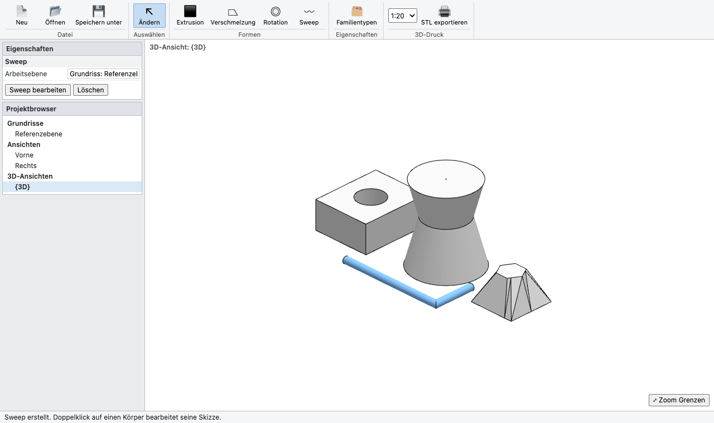

# RevPrint3D

**3D-Druck für Revit-Leute.** Ein kleiner Familieneditor im Browser, der sich wie der Revit-Familieneditor bedient. Man skizziert, formt Körper mit Extrusion, Verschmelzung, Rotation und Sweep und steuert alles über Parameter und Formeln. Am Ende steht eine STL-Datei für den 3D-Drucker.

Wer Revit kann, muss kein neues CAD-Programm lernen, um ein Namensschild, einen Stiftehalter oder ein kleines Häuschen zu drucken.

**👉 Direkt ausprobieren: https://joergsf4.github.io/revprint3d/**



## Starten

- **Online:** Link oben öffnen. Alles läuft im eigenen Browser, es wird nichts hochgeladen.
- **Offline:** Unter [Releases](https://github.com/joergsf4/revprint3d/releases) die ZIP-Datei laden, entpacken und `index.html` doppelklicken. Es braucht keine Installation und keinen Server. Der Ordner läuft auch vom USB-Stick.

Getestet mit aktuellem Chrome und Edge.

## Arbeiten wie in Revit

| In Revit | In RevPrint3D |
|---|---|
| Projektbrowser: Grundriss, Ansichten, {3D} | Projektbrowser links: Referenzebene, Vorne, Rechts, {3D} |
| Erstellen › Formen | **Extrusion**, **Verschmelzung**, **Rotation**, **Sweep** (die Arbeitsebene ist die aktuelle Ansicht) |
| Skizzenmodus mit Linie, Rechteck, Kreis, Vieleck, ✔ / ✘ | Gleich. Innere geschlossene Konturen werden zu **Öffnungen** |
| Zeichnen mit Klick, Klick | Geht genauso, zusätzlich Drücken, Ziehen, Loslassen |
| Länge eintippen + Enter | Beim Linienwerkzeug: Zahl tippen, Enter setzt den Punkt in Mausrichtung |
| Familientypen, Formeln | **Familientypen**: Parameter mit Formeln, z. B. `Breite - 2 * Rahmen` |
| Eigenschaften-Palette | Extrusionsanfang/-ende und Skizzenmaße als Zahl oder Formel |
| Doppelklick auf Körper | Öffnet die Skizze zum Bearbeiten |
| Mittlere Maustaste / Umschalt + Mitte | Verschieben / 3D-Ansicht drehen, Mausrad zoomt |

Alle Maße sind in **mm**.

### Die vier Formen

- **Extrusion:** Kontur gerade herausziehen, zwischen Extrusionsanfang und -ende.
- **Verschmelzung:** Basis skizzieren, dann **Oben bearbeiten** und die obere Kontur zeichnen, z. B. unten ein Quadrat und oben ein Kreis. Beide Skizzen brauchen genau eine Kontur.
- **Rotation:** Profil auf einer Seite der senkrechten grünen Referenzebene zeichnen. Um diese Achse wird es einmal ganz herumgedreht, ideal für Vasen, Kegel und Figuren.
- **Sweep:** Erst den Pfad zeichnen: eine offene Linie (mit Enter oder ✔ beenden) oder eine geschlossene Kontur. Dann **Profil bearbeiten** und den Querschnitt um den Kreuzungspunkt der Referenzebenen zeichnen (X = seitlich zum Pfad, Y = Höhe). An Ecken wird auf Gehrung geschnitten.

## Tipps für den 3D-Druck

- **Maßstab vor dem Export wählen.** 1:1 passt bei Bauteilgrößen auf kein Druckbett. Nach dem Export zeigt die Statusleiste die tatsächliche Druckgröße an.
- **Wandstärken nach Maßstab denken:** Unter ca. 0,8 mm (gedruckt!) wird es kritisch. Bei 1:20 sind das 16 mm im Modell.
- **Überlappende Körper sind kein Problem.** Der Slicer (PrusaSlicer, Cura, Bambu Studio, OrcaSlicer) vereint sie beim Import.
- **Flache Seite nach unten.** Die STL ist Z-oben, wie in Revit. Im Slicer lässt sich das Teil noch drehen.

## Speichern

Die aktuelle Familie wird automatisch im Browser gespeichert. **Speichern unter** legt zusätzlich eine `.rp3d.json`-Datei an. Damit lässt sich die Familie sichern, weitergeben und über **Öffnen** wieder laden.

## Was (noch) fehlt

Abzugskörper (Löcher durch andere Körper schneiden), Bögen, Teil-Rotationen unter 360°, Rückgängig sowie eigene Referenzebenen mit Bemaßungen. Wünsche gern als [Issue](https://github.com/joergsf4/revprint3d/issues).

## Technik

Reines HTML, CSS und JavaScript ohne Build-Schritt. Gerendert wird mit [three.js](https://threejs.org) r147, das im Ordner `vendor/` mitgeliefert wird. r147 ist die letzte Version mit klassischen Skripten; nur so öffnet sich die App per Doppelklick über `file://`. Beim Start prüft sich die App selbst (Formeln, Dichtheit der Körper). Das Ergebnis steht in der Browser-Konsole.

```
index.html   Oberfläche
app.js       Modell, Formeln, Formen, Skizzen, Ansichten, STL-Export
style.css    Revit-Optik
vendor/      three.js r147 (MIT)
```

## Lizenz

[MIT](LICENSE). three.js © three.js authors, MIT.
